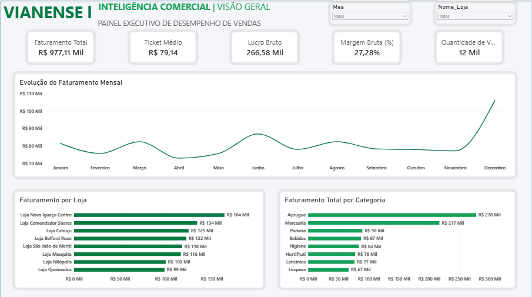
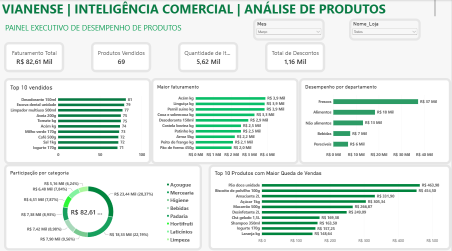
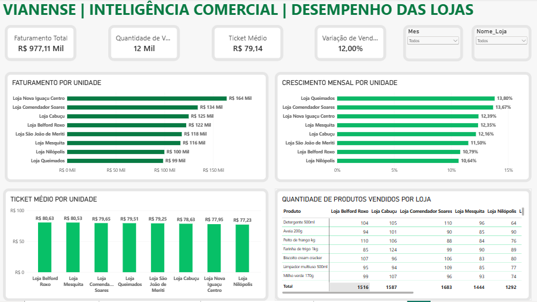
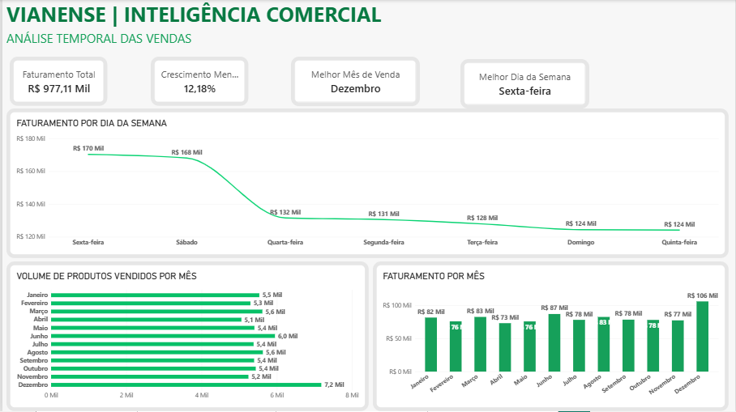

# Dashboard-Inteligencia-Comercial-Vianense
Dashboard de Inteligência Comercial desenvolvido em Power BI para análise de desempenho de supermercados.

Este projeto foi desenvolvido com base em uma experiência prática de Inteligência Comercial, envolvendo análises de desempenho de vendas de uma operação supermercadista com 19 filiais.

Para fins de demonstração e publicação no portfólio, foi construída uma base de dados fictícia com 8 unidades, preservando a estrutura analítica e as principais funcionalidades utilizadas nas análises originais.

O dashboard demonstra como os dados podem ser transformados em indicadores estratégicos para acompanhamento de resultados, comparação entre lojas e identificação de oportunidades comerciais.

## 📈 Dashboard – Visão Geral

## 🛒 Análise de Produtos

## 🏬 Desempenho das Lojas

## 📅 Análise Temporal

## 📥 Arquivo do Projeto

[Baixar Dashboard Power BI](Dashboard_Vianense_Vendas.pbix)
